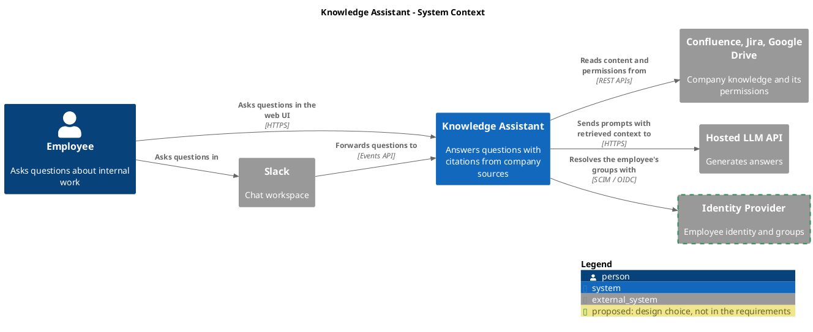
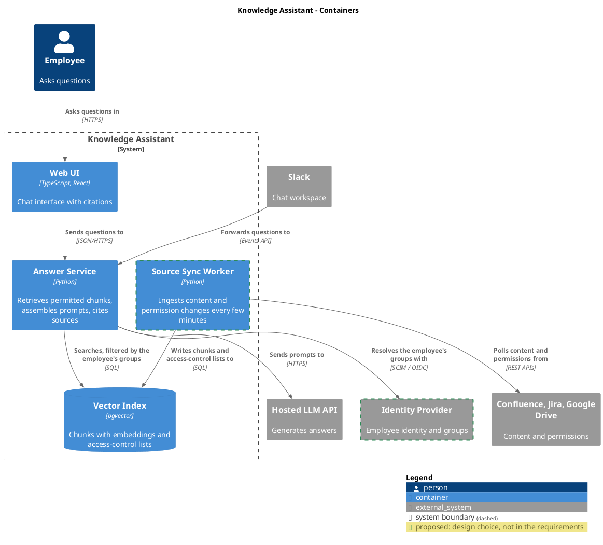
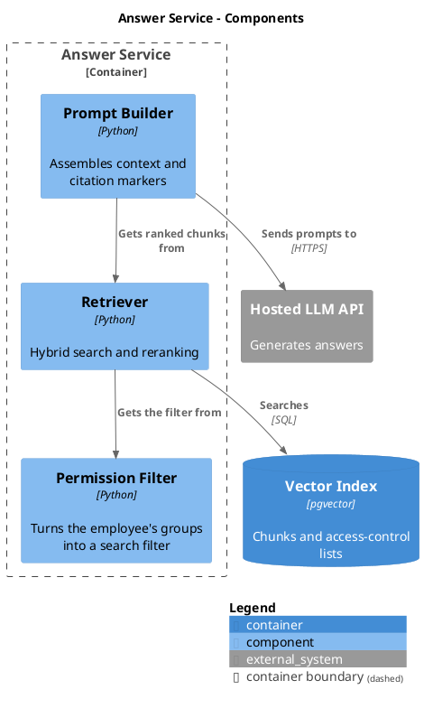

# C4-PlantUML reference

C4-PlantUML (`plantuml-stdlib/C4-PlantUML`) ships inside PlantUML's standard library, so `!include <C4/...>` works offline. The examples below render with PlantUML 1.2026.9 under `PLANTUML_SECURITY_PROFILE=SANDBOX`.

## Includes

Include the file for the deepest level the diagram uses; each one loads the levels above it.

| Diagram | Include |
|---|---|
| System Context | `!include <C4/C4_Context>` |
| Container | `!include <C4/C4_Container>` |
| Component | `!include <C4/C4_Component>` |

Do not include `https://raw.githubusercontent.com/...` or any other URL.

## Elements

| Macro | Use |
|---|---|
| `Person(alias, "Name", "Description")`, `Person_Ext(...)` | a person or role |
| `System(alias, "Name", "Description")`, `System_Ext(...)`, `SystemDb_Ext(...)` | the system, or one outside the boundary |
| `Container(alias, "Name", "Technology", "Responsibility")` | a runnable unit |
| `ContainerDb(...)`, `ContainerQueue(...)` | a data store, a queue or stream |
| `Container_Ext(...)` | a container owned by someone else, when its detail matters |
| `Component(alias, "Name", "Technology", "Responsibility")`, `ComponentDb(...)` | a part inside one container |
| `System_Boundary(alias, "Name") { ... }`, `Container_Boundary(alias, "Name") { ... }` | the boundary being zoomed into |
| `Rel(from, to, "Verb phrase", "Protocol")` | a relationship; `BiRel` only for a real two-way flow |

Keep descriptions to one line. Layout: `LAYOUT_LEFT_RIGHT()` for wide views, `LAYOUT_TOP_DOWN()` (default) otherwise; add `Rel_R`, `Rel_D`, `Lay_R` hints only when automatic layout is unreadable.

## Status tags

Define the tags once, after the include, and attach them to elements or relationships. The legend then explains them.

```plantuml
AddElementTag("inferred", $borderStyle=DashedLine(), $borderThickness="2", $borderColor="#B8860B", $legendText="inferred: not observed in the repository")
AddElementTag("proposed", $borderStyle=DashedLine(), $borderThickness="2", $borderColor="#2E8B57", $legendText="proposed: design choice, not in the requirements")
AddRelTag("inferred", $lineStyle=DashedLine(), $legendText="inferred relationship")
AddRelTag("proposed", $lineStyle=DashedLine(), $legendText="proposed relationship")
```

Use `$tags="inferred"` or `$tags="proposed"` as the last argument: `ContainerDb(db, "Warehouse", "PostgreSQL", "Product events", $tags="inferred")`, `Rel(api, db, "Reads", "SQL", $tags="inferred")`. Observed and Given elements carry no tag.

## Example: System Context



## Example: Container



## Example: Component

Zoom into one container with `Container_Boundary` and keep its neighbours as plain containers or external systems:



## Local commands

```bash
PLANTUML_SECURITY_PROFILE=SANDBOX plantuml -checkonly diagrams/kb_c4_container_overview.puml
PLANTUML_SECURITY_PROFILE=SANDBOX plantuml -tsvg diagrams/kb_c4_container_overview.puml
PLANTUML_SECURITY_PROFILE=SANDBOX plantuml -tpng -o /tmp/kb-diagrams diagrams/kb_c4_container_overview.puml
```

`-checkonly` exits 0 when the source parses and 200 on an error, including a refused include. `-o` with an absolute path writes outside the project. PlantUML needs Java and, for most C4 layouts, Graphviz; the Homebrew `plantuml` formula installs both.
