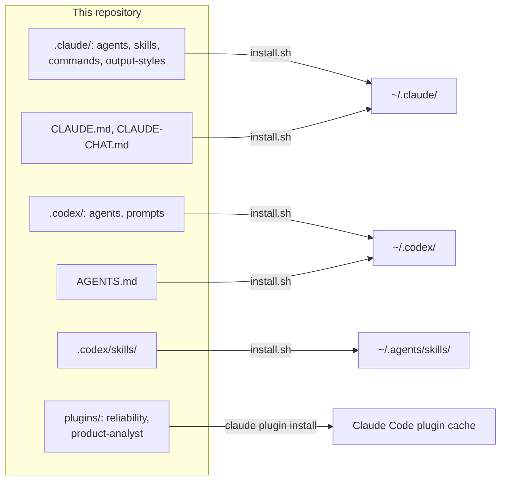

# just-works

Drop-in AI agent workflows, coding skills, and prompt standards for **Claude Code** and **OpenAI Codex**.

Fork of [dynokostya/just-works](https://github.com/dynokostya/just-works), maintained independently; upstream changes are reviewed and recorded in [UPSTREAM.md](UPSTREAM.md).

`install.sh` copies the Claude Code and Codex trees into your home directory, and the Claude Code plugin manager installs the plugins (see [Plugins](#plugins)):



## Quick start

```bash
git clone https://github.com/vbabenko97/just-works.git
cd just-works
./install.sh
```

The installer overwrites the global `~/.claude/CLAUDE.md`, `~/.claude/CLAUDE-CHAT.md` and `~/.codex/AGENTS.md`, and asks first whether to back up the existing destinations. Read [Installation](#installation) for what it keeps, what it replaces, and its options.

Install globally to use shared agents, coding skills, and documentation workflows across projects. Keep project skill directories for skills specific to that project.

Use the global installer for Codex setup. This repo's `.codex/config.toml` also loads as a project layer when Codex trusts this checkout; see [Codex ownership](UPSTREAM.md#codex-ownership--installation-baseline-and-a-live-project-layer).

## What's Inside

**Concise responses** — `minimal-coding` guides least-code solutions; invoke `caveman` for compressed conversation output. This repo's `.claude/settings.json` selects the `compressed` output style, which trims filler, hedging, and emojis to reduce response tokens and context use, potentially lowering token-based costs. The global installer uses `settings.json.default`, which selects `default` (and keeps an existing config unless `--replace-config` is passed).

**Full Claude Code fluency** — uses the whole toolset by default: `AskUserQuestion` for structured choices, rich markdown, `TaskCreate` progress tracking, and parallel tool calls.

**Context-isolating subagents** — delegates independent workstreams, such as one of several parallel changes, to subagents that carry their own context; the main session makes other code edits itself with the matching coding skill.

**Agents** — language writers for delegated workstreams (`python`, `typescript`, `swift`, `csharp`, `react`, `flutter`), plus `prompt-writer`, `diagrammer`, `reviewer`, `test-runner`, `docs-agent`, `refactor-agent`, `cv-claim-verifier`, and a personal-finance set (`personal-cfo-agent`, `risk-officer-agent`, `investment-committee-agent`, `career-capital-agent`). 17 per provider, plus three Claude-only `/goal` roles (`goal-architect`, `goal-implementer`, `goal-security`).

**Commands** — `project-docs` and `git-sync` (Claude & Codex), `plan-reviewer` (Codex).

**Skills** — applied automatically based on task intent or, for language and framework skills, the file type being edited.

| Area | Skills |
|---|---|
| Coding standards | Python, TypeScript, React, Tailwind, shadcn/ui, Swift, C#, Dart/Flutter |
| REST APIs | `rest-api` URL conventions, methods, status codes, errors, pagination, versioning and authentication |
| Code quality and repository cleanup | `clean-code-reviewer` review and refactoring for readability and maintainability<br>`repo-professionalizer` reorganizing a repository for review, handoff or open source |
| Architecture patterns | DDD, feature-driven |
| Issue-tracker tickets | `ticket-writing` titles, sections per ticket type, acceptance criteria and bug reproduction fields for Jira, Linear, ClickUp, GitHub Issues and Asana<br>`sprint-estimation` story points, when asked for an estimate |
| SQL | `sql-assistant` writes, reviews, optimizes, and converts SQL for PostgreSQL, MySQL, MariaDB, SQL Server, Oracle, SQLite, BigQuery, Snowflake, and DuckDB, with per-engine references and rules for when SQL may be executed |
| ML system design | `ml-system-design` authoring, with one template for predictive ML and one for RAG, LLM applications and agents<br>`ml-system-design-review` rubric-graded critique<br>`ai-stage-gate` Go/Kill gate reviews |
| C4 architecture diagrams | `c4-architecture` draws system context, container and component views in C4-PlantUML, from an existing repository or from requirements, and renders them locally; the `diagrammer` agent loads it |
| PlantUML diagrams | `plantuml-diagramming` diagram type selection, syntax and styling for `.puml` files |
| Data analysis | `ai-analyst-pipeline` six-phase analysis of CSV or Excel data, from framing the question to validated findings, charts and delivery |
| ML experiment discipline | `ml-problem-and-data-audit` problem contract, data, split, and leakage audit with a readiness verdict<br>`ml-experiment-protocol` baselines, fair comparison, and protected final test<br>`ml-provenance-and-handoff` run records and reproducible result notes<br>`scikit-learn` implementation patterns that follow the accepted protocol |
| Document work | `lossless-doc-compress` compression with preservation checks<br>`human-writing` for documents that readers outside the project can follow<br>`staged-docs` for building a document with its author piece by piece, invoke manually with `/staged-docs <topic>` |
| Predictive UX evaluation of web UIs | `predictive-ux-evaluation` |
| Model-specific prompt engineering | `opus-5-5-prompting` Claude Opus 5.5, `gpt-6-prompting` GPT-6, `grok-4-7-prompting` Grok 4.7<br>`claude-science-prompting` research prompts for Claude Science<br>`safe-prompt-rewriter` clearer, policy-compliant rewrites of a prompt |
| Presentations | `powerpoint-designer` finished `.pptx` decks, slide-by-slide design briefs and critiques |
| Skill and MCP authoring | `skill-creator` creating, editing and evaluating skills<br>`mcp-builder` designing MCP servers that connect a model to external services |
| Blender 5.2 expert tools | `scenario-blender-expert` router + 12 specialists, from scenario-labs/skills |
| Evidence-first family-history research in former-USSR and Russian Empire archives | `ex-ussr-kinship-research`, from DenisSergeevitch/ex-ussr-kinship-research |
| Demo-video production | `saas-product-demo-production`, `screen-demo-production`, `storyboard-previsualization`, `editing-montage`, `captions-media-accessibility`, `generated-media-qa`, `media-provenance-rights`, `media-qc-delivery`, from calesthio/generative-media-skills<br>`short-form-video`, `caption-animation`, from iart-ai/tiktok-video-skills<br>`app-demo-agent` with `voice-generation`, `music-generation`, `media-utils`, from michaelboeding/skills<br>`demo-video`, from Hmache/demo<br>`app-demo-agent`, `voice-generation`, `music-generation` and `demo-video` invoke manually, because they call paid APIs or drive a live site |
| Job applications | `career-application-builder` evidence-checked CVs and letters<br>`job-triage` vacancy screening<br>`interview-drill` mock interviews |
| MSCA Postdoctoral Fellowship 2026 applications | `msca-pf-european-2026` drafting and final audit of a European Fellowship application<br>`msca-pf-2026-reviewer` evaluator-style review and repair plan<br>`msca-text-humanizer` natural academic English for the proposal and CV |
| Personal finance | `bank-broker-due-diligence`, `cashflow-and-net-worth-auditor`, `debt-and-obligation-prioritizer`, `emergency-fund-planner`, `finance-data-normalizer`, `finance-privacy-redactor`, `financial-stress-tester`, `income-optimizer`, `investment-policy-builder`, `portfolio-rebalancer-and-risk-review`, `subscription-and-expense-auditor`, `tax-and-residency-watch` |
| GitHub profile and README presentation | `github-presentation`, invoke manually |
| Delegated task execution | `goal` runs a task with selective delegation to Claude specialists and an optional Codex review, invoke manually with `/goal` |
| Behavioral modes | `minimal-coding`<br>`i-have-adhd` output shaped for a reader with ADHD, invoke with `/i-have-adhd` |

**Permission rules** — this repo's `.claude/settings.json` denies `Read` access to `.env` files, `*.pem`, `*.key`, credentials, cloud configs, SSH keys, Terraform state, and database files. The global install template, `settings.json.default`, has an empty deny-list.

## Documentation workflows

The documentation rules in [AGENTS.md](AGENTS.md#documentation) and [CLAUDE.md](CLAUDE.md#documentation) require updates alongside the behavior they describe. They distinguish implemented behavior from agreed requirements and use existing documentation locations.

| Task | Claude Code | Codex |
|---|---|---|
| Generate or update project and feature documentation; check requested capability coverage | [project-docs](.claude/commands/project-docs.md) | [project-docs](.codex/prompts/project-docs.md) |
| Write documentation from implementation and requirement evidence | [docs-agent](.claude/agents/docs-agent.md) | [docs-agent](.codex/agents/docs-agent.toml) |
| Shorten documents while checking preservation of their information | [lossless-doc-compress](.claude/skills/lossless-doc-compress/SKILL.md) | [lossless-doc-compress](.codex/skills/lossless-doc-compress/SKILL.md) |

Compression reports the preservation checks performed and their limits; it cannot certify semantic equivalence. Open Knowledge Format (OKF) is optional and applies only within an adopted or requested scope.

## Installation

`install.sh` installs agents, skills, commands, and settings globally to `~/.claude/`, `~/.codex/`, and `~/.agents/skills/`. Before copying, it asks whether to back up the existing destinations to `~/just-works-backups/<timestamp>/`; without a terminal it backs up without asking, and answering "n" or passing `--no-backup` turns backups off. A run that backs up keeps the newest three of these `<timestamp>` directories and deletes older ones; `--keep-backups N` changes the count, `--keep-backups 0` keeps all, and other entries in `~/just-works-backups/` are never touched. An existing `settings.json`, `config.toml`, or `hooks.json` is kept unless you pass `--replace-config`, and entries you added under names this repo doesn't ship are left in place. On each side that runs, `CLAUDE.md` and `CLAUDE-CHAT.md` (Claude) and `AGENTS.md` (Codex) are overwritten — `--skip-config` does not protect them — and so is `statusline-command.sh` unless you pass `--skip-statusline`; all are backed up when backups are on.

### From source

Clone the repository and run `./install.sh`, as in [Quick start](#quick-start). To update: `git pull && ./install.sh` (existing config files are kept; add `--replace-config` to refresh them).

`install.sh` leaves project skill directories unchanged. The former `--repos` option is rejected before installation, including with `--prune` or `--dry-run`. Remove it from saved commands and scripts. `--prune` removes obsolete installer-owned entries from global destinations; it does not clean up copies in projects. Skill-creator evaluation workspaces (`<skill>-workspace/` directories, ignored by Git) are not installed, and `--prune` removes copies that earlier runs installed.

To clean up copies left by earlier installs, compare complete skill directories with the shared source, preserve local changes, and move confirmed copies to a backup outside the project's skill directories. Check that the corresponding global skill is installed before removing its project copy. Keep project-specific skills in place. This source repository retains both provider trees for distribution.

Most protections above apply to `install.sh` only. On Windows, `install.bat` is a separate, older script: it has no `--prune`, `--replace-config`, `--keep-backups`, or `--personal` refusal, it also installs skill-creator workspaces, and it overwrites existing config files. Like `install.sh`, it leaves entries you added in place: with backups off it deletes only the files it is about to replace, never a destination directory.

`bootstrap.sh` (upstream's `curl | bash` one-liner) downloads `dynokostya/just-works` and runs that repository's own installer unless `JUST_WORKS_REPO` (set in `bash`'s environment) names another repository; the npm package `@dynokostya/just-works` is upstream's. By default both install upstream, not this fork — use the source checkout above.

### `--personal`

`install.sh` refuses `--personal` for the Claude side and exits before installing anything: it would install this repository's `.claude/settings.json` as `~/.claude/settings.json`, and the installer cannot merge into an existing one. `--personal --codex-only` remains available and installs the opinionated Codex `config.toml` instead of `config.toml.default`:

| `~/.codex/config.toml` (without `--azure`) | Default | `--personal --codex-only` |
|---|---|---|
| Model | `gpt-5.5`, `medium` reasoning effort | not set |
| Sandbox / approvals | not set | `workspace-write`, `approval_policy = "never"` |
| MCP servers | none | Playwright |

Both profiles install the same `hooks.json`, a `Stop` hook that plays a sound with `afplay /System/Library/Sounds/Glass.aiff`; only the personal `config.toml` sets `[features] hooks = true`. `afplay` and that sound file are **macOS-only** — on Linux/Windows swap `afplay` for your player (`paplay`/`aplay` on Linux), or remove the hook.

### Options

`install.sh` accepts:

```bash
--personal              # opinionated profile; refused for the Claude side, use with --codex-only
--azure                 # Codex: Azure OpenAI config instead of the direct OpenAI API
--dry-run               # preview without changes
--skip-config           # skip settings.json, config.toml, hooks.json
--skip-statusline       # skip statusline-command.sh
--skip-skills-claude    # skip Claude Code skills
--skip-skills-codex     # skip Codex skills
--claude-only           # skip Codex
--codex-only            # skip Claude
--no-backup             # skip backup prompt, disable backups (for CI/scripts)
--keep-backups N        # keep the newest N installer backups in ~/just-works-backups/ (default 3, 0 keeps all)
--prune                 # delete entries a previous run installed that are gone from the source (tracked in ~/.just-works-manifest)
--replace-config        # overwrite existing settings.json / config.toml / hooks.json (backed up when backups are on)
-h, --help              # show help
```

### Codex Azure config

Azure configs are installed only with `--azure`: `.codex/config/azure/config.toml.default` → `~/.codex/config.toml`, or `.codex/config/azure/config.toml` with `--personal --codex-only --azure`. An existing `~/.codex/config.toml` is kept unless you also pass `--replace-config`.

Then edit the file — replace `<your-resource-name>` with your Azure OpenAI resource and set your environment variable:

```bash
export AZURE_OPENAI_API_KEY="your-key-here"
```

### MCP for Claude Code

MCP servers are configured per-project, not globally. To set up MCP in your project, copy one of two files: `.mcp.json.default` declares no servers, and `.mcp.json` declares the Playwright server.

```bash
cp .mcp.json.default /path/to/your/project/.mcp.json
```
OR
```bash
cp .mcp.json /path/to/your/project/.mcp.json
```

Requires `npx` (Node.js) in your PATH.

## Plugins

This repository is also a Claude Code plugin marketplace named `just-works`, declared in `.claude-plugin/marketplace.json`. It holds two plugins. `install.sh` does not install them; the Claude Code plugin manager does.

| Plugin | What it does |
|---|---|
| `reliability` | Guards that deny an action when they cannot run, instead of allowing it. In every project it denies recognised destructive operations, mutations whose targets it cannot bound, edits to the configuration that governs the agent, and attempts to disable the plugin. A repository can add restrictions in `.claude/reliability-policy.json`, such as reviewed-script pinning and extra protected paths, but cannot weaken the rules that apply in every project. |
| `product-analyst` | Read-only product investigations across PostgreSQL, PostHog and Amazon QuickSight, with evidence records and independent claim verification. Run `/product-analyst:investigate`. Setup and requirements are in [plugins/product-analyst/README.md](plugins/product-analyst/README.md). |

```bash
claude plugin marketplace add vbabenko97/just-works
claude plugin install reliability@just-works
claude plugin install product-analyst@just-works
```

To update a plugin, run `claude plugin marketplace update just-works`, then `claude plugin update reliability@just-works` (or `product-analyst@just-works`), and restart Claude Code. [docs/owner-plugin-procedure.md](docs/owner-plugin-procedure.md) covers updates and rollback for `reliability`.

## Project Structure

```
.claude/
  agents/           # Claude Code agent definitions
  skills/           # Coding and prompting standards
  commands/         # Multi-step workflows (project-docs, git-sync)
  output-styles/    # Selectable output styles (compressed)
  hooks/            # maintenance_auth.py (owner maintenance check)
  settings.json     # Permissions, hooks, env, MCP toggles
.codex/
  agents/           # Codex custom agent definitions (TOML)
  prompts/          # Codex slash commands (plan-reviewer, ...)
  skills/           # Skills copied from .claude/ (a subset)
  config/azure/     # config.toml.default + config.toml
  hooks.json        # Lifecycle hooks (notification)
.claude-plugin/
  marketplace.json  # Claude Code plugin marketplace (reliability, product-analyst)
plugins/
  reliability/      # Guard hooks, policy layer and their tests
  product-analyst/  # Read-only product investigation plugin
scripts/verify/     # bulk_mutate.py, verify_tree_equivalence.py, policy and maintenance helpers
tests/              # Installer, reliability, /goal and skill tests
docs/               # Architecture, plugin procedures and guard notes
install.sh          # Global installer
install.bat         # Older Windows installer
bin/cli.mjs         # npx installer
CLAUDE.md           # Behavioral instructions for Claude Code
CLAUDE-CHAT.md      # Behavioral instructions for claude.ai chat
AGENTS.md           # Behavioral instructions for Codex
UPSTREAM.md         # Upstream intake log and standing decisions
```

`.claude/` and `.codex/` are parallel and independent — use one or both.

## Customization

Add project-specific agents in `.claude/agents/` or `.codex/agents/`. Override skill defaults in your own `CLAUDE.md` or `AGENTS.md`. Extend the deny-list in `.claude/settings.json`.

If you fork this: a skill you want in both providers has to be copied into both trees (Codex doesn't support `@file` references). The trees are not required to match — each carries skills the other lacks. Keep instructions model-agnostic.

## License

Apache 2.0
